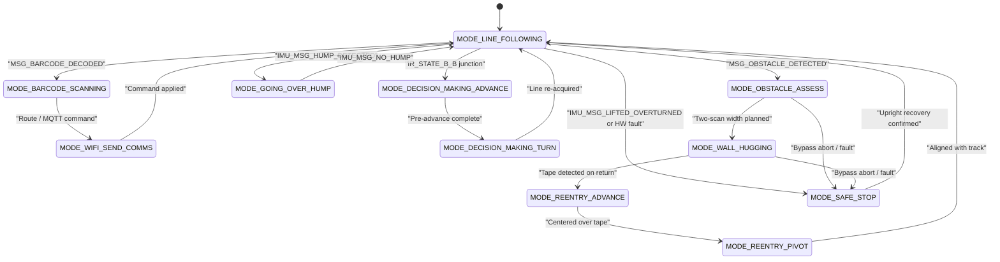
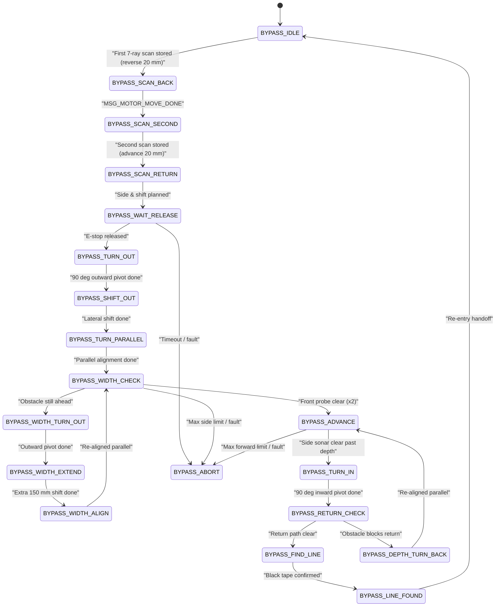
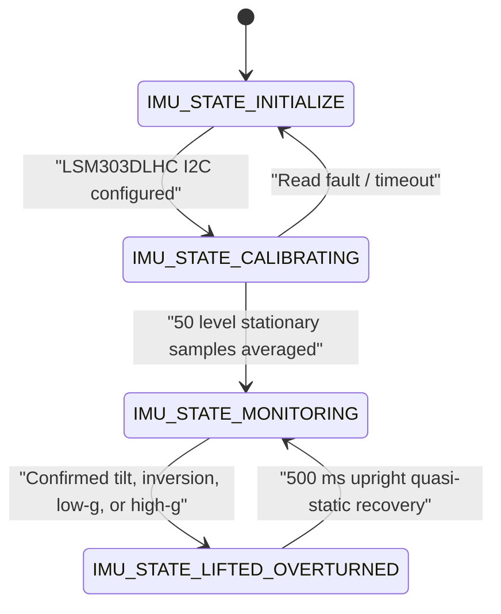
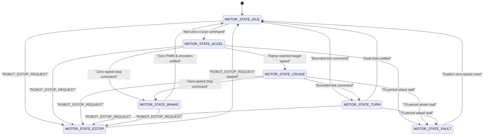
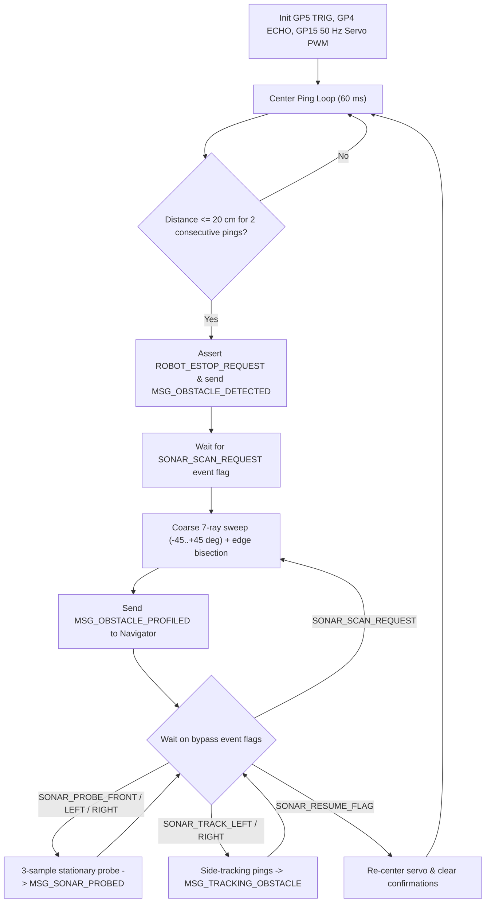

# Firmware Finite State Machine Diagrams (BARR-C:2018 Rule 2.2.f)

This version-controlled document maintains the state machine and workflow diagrams referenced by [navigator_task.h](../../app_program/navigator/navigator_task.h), [navigator_task.c](../../app_program/navigator/navigator_task.c), [imu_task.c](../../app_program/imu/imu_task.c), [motor_task.c](../../app_program/motor/motor_task.c), and [ultrasonic_task.c](../../app_program/ultrasonic/ultrasonic_task.c).

---

## 1. Central Navigator FSM (`navigator_task`)

---

## 2. Rectangular Obstacle Bypass Sub-FSM (`navigator_task` + `bypass_helpers`)

---

## 3. IMU Calibration, Hump & Lift/Overturn Safety FSM (`imu_task`)

---

## 4. Closed-Loop Motor Control FSM (`motor_task`)

---

## 5. Ultrasonic Detection, Profiling & Side-Tracking Workflow (`ultrasonic_task`)

