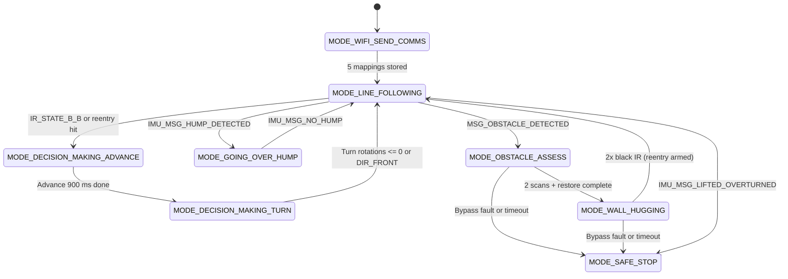
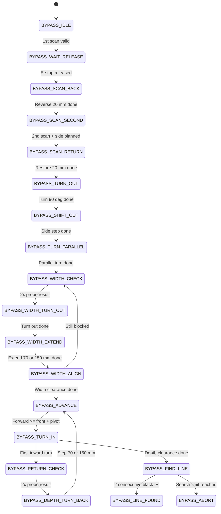
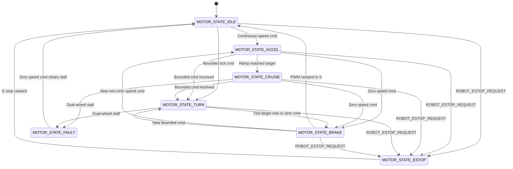
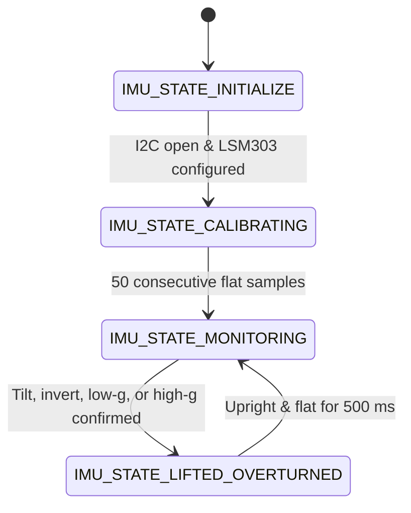

# Finite State Machine Diagrams (BARR-C:2018 Rule 2.2.f)

Version-controlled state machine specifications referenced by the firmware
modules under `app_program/`.

## 1. Navigator Top-Level FSM (`app_program/navigator/navigator_task.c`)

## 2. Rectangular Obstacle Bypass FSM (`app_program/ultrasonic/bypass_helpers.c`)

## 3. Motor Controller FSM (`app_program/motor/motor_task.c`)

## 4. IMU Monitoring FSM (`app_program/imu/imu_task.c`)

